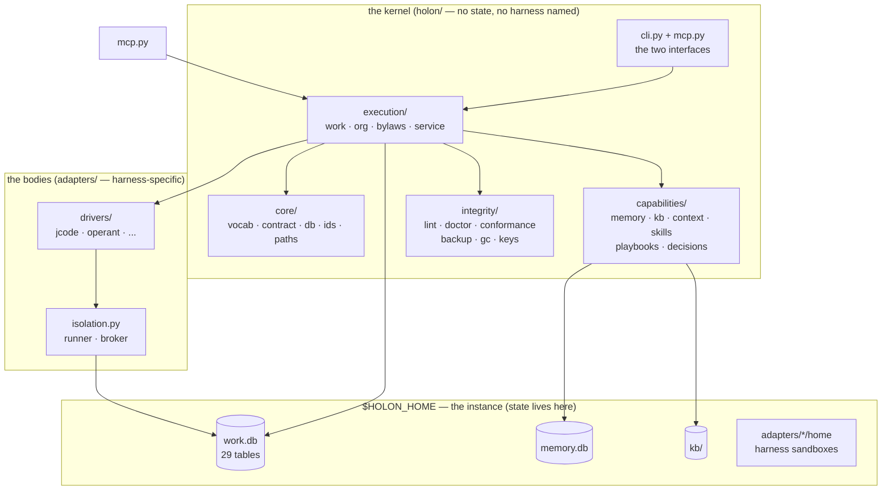
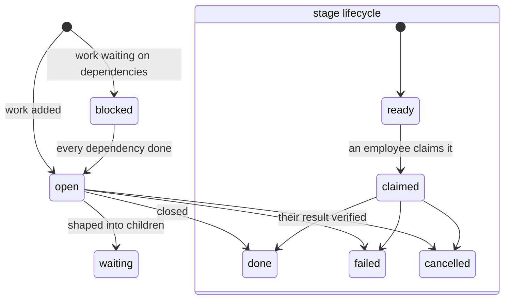
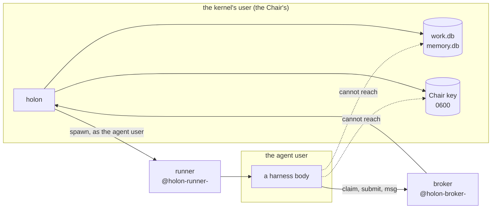
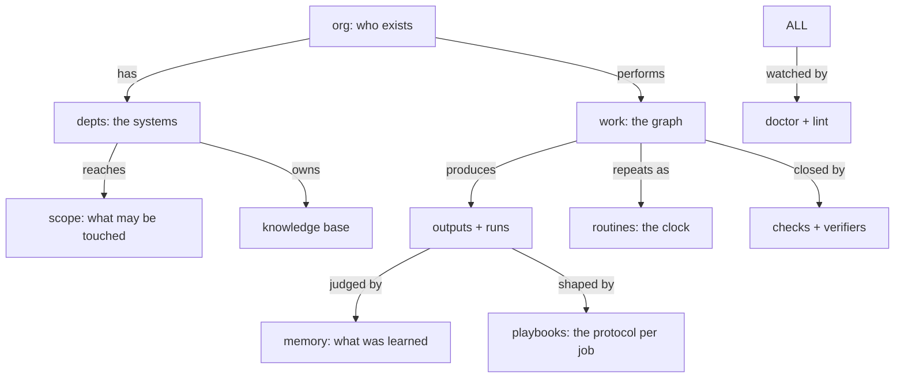

# Architecture

One page for the question "how does this thing work?" Written for an agent arriving to change
the kernel. It names each part by what it owns, what it may not touch, and the one document that
states its rules. Every claim here is checkable against the code in the same line.

## The shape

Holon is a **kernel** (a source distribution that ships no state) that runs an **organization**
inside an **instance** at `$HOLON_HOME` (SQLite + the Chair key + the harness homes). One process
at a time writes any database; nothing else opens it for writing.



## The one rule that shapes everything

**One writer per database.** `holon.execution.work.Work` is the *only* writer of `work.db`; `holon
.capabilities.memory.Memory` is the only writer of `memory.db`; `holon.capabilities.kb` the only
writer of `kb/`. Every other capability opens them read-only. Law 3 in `AGENTS.md`, enforced by
`holon lint`. It is why the system can be audited at all: there is exactly one place a status
change, a lesson or a knowledge entry can come from, and it logs a hash-chained event when it does.

Corollary: a new capability that needs its own store opens its own file. It never reaches into
another capability's.

## Where things live

| Package | Owns | Never does |
|---|---|---|
| `holon/core/vocab.py` | every enumeration: roles, stages, statuses, lanes, kinds | — (nothing else may define one) |
| `holon/core/contract.py` | a stage's result envelope, and its validators | reach a database |
| `holon/core/db.py` | SQLite connect, migrations, the hash-chained audit trail | decide policy |
| `holon/core/ids.py` | typed ids (`tsk_`, `run_`, `emp_`, `dept_`) | — |
| `holon/core/paths.py` | every path inside `$HOLON_HOME` | — |
| `holon/execution/work.py` | the work graph: tasks, task_needs, outputs, runs | hire, grade or judge |
| `holon/execution/org.py` | departments, employees, authority, evidence-based reviews | open a run |
| `holon/execution/bylaws.py` | role → stage mapping, profiles, slots | read the database directly |
| `holon/execution/autonomy.py` | what each actor may approve | mutate the graph |
| `holon/execution/service.py` | the kernel: the rules engine, claims, ingestion, sampling, triggers, metrics | — (it composes the rest) |
| `holon/execution/security.py` | the Chair key, employee keys, run tokens | spawn a harness |
| `holon/execution/isolation.py` | the trust boundary: the runner, the broker, the setup plan | name a harness |
| `holon/execution/drivers.py` | how one agent turn is run and its result read | know which department |
| `holon/execution/ventures.py` | reading a venture's artifacts into the kernel | decide approval |
| `holon/capabilities/memory.py` | institutional memory (scopes, kinds, promotion) | write `work.db` |
| `holon/capabilities/kb.py` | knowledge bases and their blueprints | — |
| `holon/capabilities/context.py` | the stage's context bundle | — |
| `holon/capabilities/skills.py` | the skills library (three layers) | — |
| `holon/capabilities/playbooks.py` | a job's protocol and rubric, versioned | — |
| `holon/capabilities/decisions.py` | the decision-model client; **every caller has a safe default** | block a run |
| `holon/integrity/lint.py` | the artifact rubric (twelve packs) | read live state |
| `holon/integrity/doctor.py` | live-state checks | check artifacts |
| `holon/integrity/conformance.py` | whether a harness speaks the contract | — |
| `holon/mcp.py` | the organization as MCP tools (stdio) | — |
| `holon/cli.py` | the command registry and its actor classes | — |

## The work graph

`tasks` is the only table that matters most. Every row is either a **work node** (`stage IS NULL`,
an outcome someone wants) or a **stage** (`stage = <a role's step>`, one unit by one role). Nodes
form a holarchy through `root_id` / `parent_id`; stages hang off their work node; `task_needs`
orders work against other work.



A stage's pipeline is fixed by the bylaws (`research → shape → plan → approve → execute → verify`,
with `retro` appended by the kernel when a run fails), so an agent never invents the order: it
claims the next ready stage its roles may perform.

**Every status change goes through `Work._set`** (law 4), which appends a hash-chained row to
`events`. That is the entire audit trail; a change that bypasses it is a lint error.

## Interfaces: two, same rules

An agent reaches the organization either way, and both authenticate the same way:

```mermaid
sequenceDiagram
  participant Body as a harness body
  participant I as CLI (holon claim/submit) or MCP (holon_*)
  participant W as Work / Service
  participant DB as work.db

  Body->>I: run token or employee key
  I->>W: Claimant(token_hash)
  W->>DB: BEGIN IMMEDIATE; one stage claimed; a run opened
  W-->>Body: the stage, its brief_dir, policy.json
  Body->>Body: does the work (its harness)
  Body->>I: the result envelope
  I->>W: validate, check, judge, settle
  W->>DB: events, outputs, runs — one transaction each
```

The worker-facing difference is small and deliberate: the CLI is for pull mode (any runtime can
`holon claim`), the MCP server is for harnesses that mount it. **Both are confined to the same
claim query**, so an interface can never grant more than the graph itself allows.

## The trust boundary

Off by default, and `holon doctor` warns until it is on. The point is that **no harness ever sees
the Chair key**: agents run as their own Unix user, through a runner, reaching the organization
only through a broker on an abstract socket.



## How the eight subsystems relate



## Reading order for changing the kernel

1. `docs/INTENT.md` — the laws. If a change breaks one, the change is wrong.
2. `AGENTS.md` — the code map above, in more detail, plus the regression ledger.
3. `docs/BYLAWS.md` — every configuration key, with its default.
4. `docs/COMMANDS.md` — the generated command reference.
5. `docs/CONTRACT.md` — the harness contract, if you touch a driver or the submit path.
6. `tests/` — the real specification. Read the guard that covers what you're changing before
   you change it; a count belongs in the run output, not in a doc that outdates itself.

## The tests are the specification

`tests/` is organised by what it proves, not by what it imports: `test_pipeline.py` is the work
graph, `test_security.py` is who may act, `test_loops.py` is the feedback loops, `test_playbooks.py`
is the learning loop, `test_adapters.py` is the harness seam, `test_integrity.py` is the rubric
itself. A change to the graph, the contract, security or a driver needs its test **first**
(`AGENTS.md` law 9), and a defect found by a real run gets a guard and a ledger row in the same
commit.

## Extending it

The three common changes, and the exact seams:

- **A new command.** Add it with `@command(path, actor, help, ...)` in `holon/cli.py`. The actor
  class is required and asserted against `vocab.ACTOR_CLASSES` (law 8). Regenerate
  `docs/COMMANDS.md`; `holon lint` fails if you forget.
- **A new configuration key.** Add it to `DEFAULT_CONFIG` in `service.py` and a row to
  `docs/BYLAWS.md` §6; the `bind.config` lint rule fails until both exist.
- **A new gate on the work graph.** A `Rules` method in `service.py`, called from the point in
  `Work` that changes the status — never a parallel mutation. Its guard goes in `tests/`, and its
  defect goes in the `AGENTS.md` ledger with a test name.

All three are checked by `holon lint --strict`, so the change is incomplete until the tooling
agrees.
