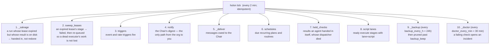
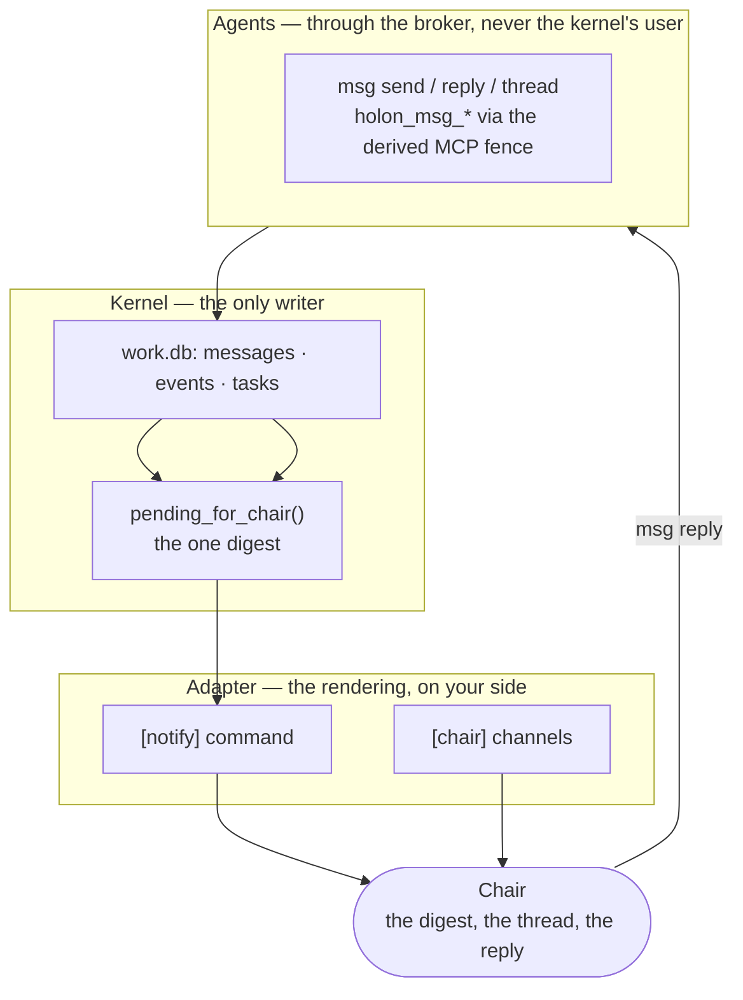

# The heartbeat, the channel, and the live activation — measured

Status: 2026-10-22T20:46Z. Live instance `/home/ishanp/holon`. Repo public `563bb2c` · 598 tests ·
lint 0/0. Backup taken before any change: `/var/tmp/ishanp-agentic/rescue/backup-pre-activation`
(1146 files).

Three approvals acted on. **Two are fully live. One is blocked on a single root command, and that
is stated plainly below.**

---

## 1. The digest now proves delivery — live and measured

`[notify] dropped_marker` is set on the live instance, against the exact text your command prints
when it has nowhere to deliver.

Measured before and after, on the live instance, with a real owed item:

| | Recorded event | Cursor | Question |
|---|---|---|---|
| **before** (the defect) | `sent` / `1 items` | advanced past it | never retried |
| **after** (now) | `failed` / `1 items: …no [chair] channels configured` | does **not** advance | stays owed, retried next tick |

```
$ holon --home ~/holon msg send chair "is the digest reaching me now?" --kind question --as emp_…
$ holon --home ~/holon tick
  ('2026-10-22T20:28:02', 'failed', '1 items: …no [chair] channels configured — the message has
   nobody to reach')
  question still owed (unacked)?  True
```

The silent drop is closed. Anything the organization owes you is now either delivered or reported
as failed — never recorded as sent having reached nobody.

---

## 2. The heartbeat is live

```
systemctl --user is-enabled holon-tick.timer  →  enabled     (the symlink survives a reboot)
systemctl --user is-active   holon-tick.timer  →  active
```

Journal, from its own runs:

```
01:58:20 holon: swept 0 expired leases; 0 triggers; fired 0 schedules
02:00:20 holon: swept 0 expired leases; 0 triggers; fired 0 schedules
02:02:21 … 02:04:21 … 02:06:21 …            (every 2 minutes, ~1s each)
```

and `.clock/last_tick` is written each tick (`1792701599`), so `doctor`'s `heartbeat.stale` check
is silent rather than guessing.

---

## 3. How `holon tick` operationalizes everything — the architecture

`holon tick` is the kernel's only clock. It is **idempotent** — call it from any timer, any number
of times, and it converges rather than duplicating. `KillMode=process` means a dispatch it starts
outlives the tick itself, so a slow body never dies because its heartbeat ended.



Three properties worth naming:

**Nothing runs inline.** Except in `holon tick --foreground`, every phase that would start a body
spawns a detached process and returns. A stuck harness cannot stall the heartbeat, and the oneshot
unit cannot take the dispatch with it when it exits.

**One failing thing does not stop the clock.** Each schedule is recorded with its own outcome; one
employee's failure is one event, not a dead heartbeat. A stage that keeps failing opens an
incident, which is how you learn about it.

**Every phase has a guard.** Eight `HeartbeatFoundation` tests across these phases, plus the
systemd validity and reboot contract, all mutation-verified. The liveness stamp at
`.clock/last_tick` is what doctor reads instead of asking you to notice missing ticks.

What it does **not** do: it does not claim work, run harnesses inline (except `--foreground`), judge
results, or decide anything. Those happen when a body is dispatched or an agent reaches the broker.

---

## 4. Isolation — measured, and blocked on exactly one root step

**Honest answer to your question: no, isolation does not guarantee complete operationalization
without gaps. It closes the identity gap, which is the one that makes the others safe.** The
remaining gaps are listed at the end of this section, measured, not guessed.

### What is now verified

`[isolation] agent_user = "holon-agent"` was set and `isolation plan` was read. It confirmed the
reach measured earlier, exactly:

```
writes: pioneer-qf (and its core/data/logs roots), the two adapter homes
reads:  the jcode, operant and claude binaries, the checkout, the instance's kb/
runs:   <instance>/execution/runtime/runs/
```

`isolation apply` was then run. **Every `setfacl` failed**, with `Invalid argument near character
3`, and **nothing was written** — verified with `getfacl` on the instance's own dotfile.

### Root cause, confirmed by isolation

```
setfacl -m "u:nosuchuser9999:rwx" <file>   → setfacl: Option -m: Invalid argument near character 3
setfacl -m "u:ishanp:rwx"        <file>   → applied: user:ishanp:rwx
```

ACLs work on this btrfs. The failure is that **`holon-agent` does not exist yet**, and creating it
is the one step that needs root:

```sh
sudo sh /tmp/holon-isolation.sh      # useradd the agent user + install the runner service
```

I do not have non-interactive sudo here, so this is yours.

### Why I reverted the config key

Setting `agent_user` **without** the runner turned the live doctor from `0 errors` to:

```
ERROR isolation.runner   the runner does not answer (cannot reach @holon-runner-…: Connection
                        refused): no agent can run
```

That is the kernel being correct rather than permissive — once you promise an agent user, the
runner is required, and it refuses to let agents run as the kernel's user instead. But it would
have left the instance unable to run any agent, so `agent_user` was reverted until the root step
can run. `dropped_marker` survived the revert and the digest fix is untouched. **Live doctor: 0
errors, 11 warnings** (the 11 were there before this session).

### What is already proven about isolation

27 tests in `tests/test_isolation.py` pass, including: a harness running through the runner as the
agent user, the broker never acting as the Chair and ignoring a caller's `--home`, agents reaching
only agent commands, the runner refusing other uids, and **`doctor_probes_what_the_agent_user_can_reach`**
— the same probe `holon doctor` runs against your instance once the runner exists.

So the order that works is: root step → `isolation apply` → start `holon-broker` → `holon doctor`.
Doing it out of order is what produced the error above.

### Gaps isolation does not close (measured)

**Where the warnings actually are, counted from the live doctor after the export:**

- **`isolation.off`** — expected: `agent_user` is not set, so agents run as the kernel's user.
  This is the one the root step closes, and it is the highest-consequence warning in the list.
- **`workdir.missing` × 2 and `artifacts.dangling` × 7** — the live record points at B-side
  scratchpads under `/var/tmp/ishanp-agentic/claude-1000/…-hermes-organism/…/scratchpad/…` that
  the retired harness era left behind. Isolation changes nothing here: `[isolation] writes` is the
  pioneer-qf scope only, so those paths are outside the agent's reach either way. These are a
  record-keeping problem — restore the files, or supersede the results — now visible because the
  doctor checks for them.

**Correction to an earlier claim of mine:** I first reported `artifacts.dangling` as ×3. The
live doctor counts **7** dangling pointers across 5 works — one `Refine playbook:
routine-notes-digest` result names 2 unresolvable paths (a relative directory and a relative
checksum pair), four absolute paths point into the retired harness era's scratchpad. My earlier
count was wrong; the check is doing its job.

**`skills.export_stale` is now cleared** — it needed `holon skill export` against *both* export
targets (`adapters/jcode/home/skills` and `adapters/operant/home/skills`), because the live
instance registers an export per adapter home. The live instance went from 11 warnings to 10 the
moment the stale copies were refreshed; only the `isolation.off` warning and the B-side pointers
remain.

---

## 5. Channels: how they are configured, and where the surface area is

### How a channel is configured

There are exactly two config keys, and they are different things:

| Key | What it does |
|---|---|
| `[notify] command` | the kernel → Chair seam. The kernel computes the digest, substitutes `{message}`, shells this, and reads the exit code as proof. `dropped_marker` closes the silent-drop. |
| `[chair] channels` | `<platform>:<user id>` refs whose channel messages count as the Chair's — for a runtime that *fronts* a channel, never for agents. The broker still forbids agents every Chair command. |

Yours are currently:

```
[notify]  command = "operant org holon notify --reason heartbeat --text {message}"
[chair]   channels = none
```

So today: the kernel computes, your adapter delivers, and **the destination is unwired** — which is
exactly what `dropped_marker` now reports instead of hiding. Wiring a real destination is an
adapter-side change (Telegram, Gmail), not a kernel change: law 2 forbids naming a platform under
`holon/`.

### The surface area, in one picture



**Where the surface actually is, concretely:**

1. **Inbound to you (one seam).** `[notify] command`. Everything owed reaches you through it —
   decisions, incidents, breaches, and now employee `question`/`request` messages. It is one
   command, and it now proves delivery.
2. **Outbound from you (one path).** `msg reply <id>` — answers in the thread it answers, back to
   whoever asked. `msg thread <id>` reads the conversation.
3. **Agent ↔ agent.** `msg send` / `msg inbox` / `msg request`, plus 56 MCP tools a mounted body
   can call, all derived from the registry's actor class.
4. **The broker** (not yet running, because isolation is not applied) is the only door from agents
   into all of it. It authenticates the run token, never the Chair key, and never reads a file on
   the agent's behalf.

**What is deliberately not a surface:** a Telegram thread per agent, and direct Gmail/Telegram
tooling with scoped authorization. Both would build a second identity or a second authorization
beside the ones the kernel binds to the authenticated principal and the registry's actor class.
The per-employee thread is a *rendering* of `messages.sender` — your adapter's job, and the kernel
does not learn the mapping exists.

## 6. The one action left, and why it is safe to do now

```sh
sudo sh /tmp/holon-isolation.sh                                 # root: the agent user + its runner
holon --home /home/ishanp/holon isolation apply                  # the ACLs (needs the user to exist)
systemctl --user enable --now holon-broker                       # install.py writes this unit
holon --home /home/ishanp/holon doctor                            # the isolation checks, probed as holon-agent
```

`[isolation] agent_user` is currently **absent** from `holon.toml` — re-add it at the same
time as the root step, or the `isolation.runner` error above returns:

```toml
[isolation]
agent_user = "holon-agent"
```

The backup at `/var/tmp/ishanp-agentic/rescue/backup-pre-activation` covers the way back.
