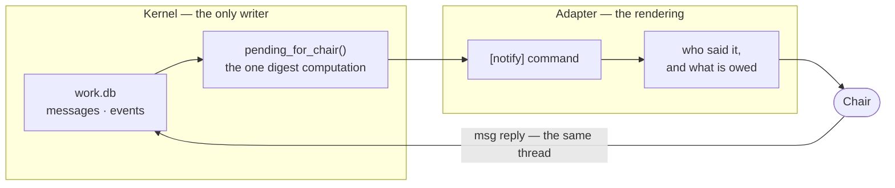

# The Chair channel: a plan for one verified path from the organization to its owner

Status: **executed** (W1, W2, W3 landed, 2026-10-22). Gates 1 and 2 are closed; gates 0 and 3 remain the Chair's live actions.
Scope: A (the holon distribution). Paperclip, ZeroClaw, the Hermes organism and the ventures
migration are untouched by this plan; nothing here is evidence about them.

## §0 What was measured before this plan was written

Seven things, each confirmed by running the code rather than reading it.

1. **An employee cannot reach the Chair today.** `pending_for_chair()` — the only computation
   that feeds the Chair's digest — selects from `events JOIN tasks` where `entity='task'`, plus
   `classifier` failures and undecided audit samples. A message is neither. `msg send` / 
   `msg request` write to `messages`, and nothing reads that table into the digest.

   Measured directly: posting `dm` and `request` rows addressed to `chair` left
   `pending_for_chair(0)` **empty**. On the live instance, 17 messages exist, **0** are addressed
   to the chair, and `entity='message'` appears **0** times in `events`.

   So the question "what should the notification channel look like" has a prior: there is no
   verified employee → Chair path at all. A design that starts from "add Telegram threads"
   would add a second surface over a first one that has never worked.

2. **The reply direction does not exist as a command.** `holon msg` has exactly three
   subcommands: `send`, `inbox`, `request`. There is no way to answer a message, so a Chair who
   reads a digest has no kernel path to answer it.

3. **`thread_id` is a dead column.** `Work._message` writes `thread_id or mid`, so every message
   starts its own thread. I then grepped every caller of `post_message` in the kernel — four of
   them, plus the CLI — and **none passes `thread_id`**. Measured: a Chair reply and the employee
   message it answers carry *different* thread ids.

   **This corrects a claim I made earlier in this session**, that the Chair's reply "was appended
   to the same thread". It is not. The column exists and no path sets it.

4. **A message has no run attribution.** `messages` carries `id, ts, sender, to_ref, kind,
   task_id, thread_id, body, ack_required, acked_at`. The only link to work is `task_id`. There
   is no run column, so a message cannot be traced to the run that produced it.

5. **Attribution exists, but only on one authentication path.** `security.principal(token)`
   resolves a run token to `Principal("employee", id, run_id)` — the run id is present.
   `security.agent_principal(token, key)` resolves an *employee key* to
   `Principal("employee", id)` with **no run_id**. So the sender an adapter sees is reliable, and
   "which run was this" is not generally answerable.

6. **The adapter is the only unknown seam.** `[notify] command` is the entire contract: the
   kernel computes the digest, substitutes `{message}`, and reads the exit code as proof of
   delivery. The live command exits 0 while printing "no [chair] channels configured", which is
   the defect `dropped_marker` now catches. No kernel code names a chat platform.

7. **The MCP surface is derived, never hand-listed** (`agent_commands()` walks the registry's
   actor class). Any command the channel needs is automatically exposed to a mounted runtime.

## §1 The design this plan argues for

**One channel, owned by the kernel, with the adapter rendering it.**

The kernel decides *who* spoke and *what* is owed. The adapter decides *how* it looks. The seam
between them is the seam that already exists and now has a guard.

Nothing new is invented at the boundary: the boundary is the one that broke silently, and it now
has a guard.

## §2 Why the two facets were not adopted as proposed

**Facet 1 — a Telegram thread per agent.** Rejected as a *topology*, accepted as a *rendering*.

The evidence is that a per-agent thread's only distinguishing feature — who is speaking — is
already the one thing the kernel binds to an authenticated identity. `cmd_msg_send` passes
`_sender(args, k)` as the sender, never the body's own claim, and `_sender` resolves the run
token. A thread that re-derives "who" from a platform-side channel id builds a *second* identity
beside the one the kernel enforces, and the regression ledger is a catalogue of that failure:

- `test_the_chair_key_never_reaches_a_harness_env`
- `test_a_shared_tree_others_commit_to_or_write_ignored_paths_in_is_not_a_breach`
- `test_an_outside_reach_import_starts_disabled_with_the_decision_model_down`

Each is "a second channel with its own authorization."

A thread per employee *rendered* by the adapter from `messages.sender` keeps identity in the
kernel and adds nothing to the trust surface. The kernel does not learn the mapping exists.

**Facet 2 — direct Gmail/Telegram tooling with scoped authorization.** The right instinct, one
layer too high.

An employee already runs as `holon-agent` (not the operator), already has scoped read/write from
`[scope]`, and is already forbidden every Chair command by the broker's derived fence. Adding
tooling "with scoped authorization" adds a second authorization system beside the first. The
correct place for scope is the actor class in the registry — already the law (law 8), already
derived into the MCP fence, already test-guarded against drift.

**What the two facets share, and why it matters.** Both assume the reach question is settled.
It is not: `doctor` reports `isolation.off`, so agents run as the operator and can read the Chair
key and write `work.db`. A notification channel over that gap is a pipe to the Chair's authority
wearing a chat platform's name. This is why isolation is gate 0.

## §3 The work, in gate order

Each item is a test first, then the mechanism, then mutation verification, then the ledger row.
Nothing below starts before its gate.

### W1 — an employee → Chair message must reach the digest

**The defect:** `pending_for_chair` reads `events JOIN tasks`, so `messages` is invisible to the
one computation that feeds the Chair. An employee asking a question or blocking on a key has no
path at all.

**Test first:** `test_an_employees_question_to_the_chair_reaches_the_digest` — post a
`question` to `chair`, assert a line naming the sender and the question appears in
`pending_for_chair(0)`; a message *not* addressed to the chair does not. Then
`test_a_delivered_digest_line_stops_being_new` — the cursor advances on send and the line does
not repeat, using the `notify_seq` semantics `dropped_marker` already relies on.

**Mechanism:** read unacked messages addressed to `chair` (kinds `question` and `request`), and
fold them into the digest lines. Ack on delivery, so a message the Chair has read stops being
new — the same cursor discipline the digest already uses, not a new one.

**Mutation:** an employee question that never reaches the digest must fail the guard.

### W2 — the Chair must be able to answer, in the same thread

**The defects:** no `msg reply` command, and `thread_id` is written by no path.

**Test first:** `test_a_reply_joins_the_thread_it_answers` — post from an employee, reply to it,
assert both messages carry one `thread_id`; `test_an_unrelated_message_starts_its_own_thread`.
Then `test_a_thread_reads_as_a_conversation` — `msg thread <id>` returns both in order.

**Mechanism:** `msg reply <message-id> <body>` takes the answered message's `thread_id` and
posts into it. `msg thread <id>` renders the thread. This is a CLI + `Work` change, no schema
change: the column already exists, and this is the first caller that sets it.

**Mutation:** a reply that starts a fresh thread must fail the guard.

### W3 — attribution, measured rather than assumed

**The measured gap:** `messages` has no run column, and employee-key authentication resolves to
a `Principal` with no run id.

**Test first:** `test_every_message_names_its_sender_and_its_work` — a message carries the sender
the kernel resolved and the task it belongs to, and no message can be posted claiming a sender
other than the authenticated one (the existing `_me` guard, asserted for messages).

**Mechanism:** nothing new to build. State it in the plan, and make the adapter read
`messages.sender` + `messages.task_id` — the two links that exist — rather than a platform-side
identity.

**Mutation:** a message whose sender is not the authenticated principal must be refused.

### §4 Gate order — a gate is a measured state, not a decision

| Gate | What must be true | Measured by | Status |
|---|---|---|---|
| 0 | No `isolation.off` | `holon doctor` | **open** — live, and the Chair's action |
| 1 | The digest proves delivery | `test_a_command_that_drops_the_message_and_exits_zero_is_a_failed_send` | **closed** (2026-10-22) |
| 2 | The units carry the reboot contract | `test_the_units_are_valid_and_the_timer_survives_a_reboot` | **closed** (2026-10-22) |
| 3 | The heartbeat is actually enabled | `systemctl --user is-enabled holon-tick.timer` | **open** — currently `disabled`, the Chair's action |
| 4 | W1: an employee question reaches the digest | `test_an_employees_question_to_the_chair_reaches_the_digest` | **closed** (2026-10-22) |
| 5 | W2: a reply joins the thread it answers | `test_a_reply_joins_the_thread_it_answers` | **closed** (2026-10-22) |
| 6 | W3: attribution asserted, not assumed | `test_a_reply_goes_back_to_whoever_asked` | **closed** (2026-10-22) |

Measured on a real instance end to end: `msg send chair "which key do I use?" --kind question
--as <emp>` writes `emp:<id> → chair` [question, owed]; `msg reply <id> "the staging key"` writes
`chair → emp:<id>` [answer] into the same thread and acks the question. Both directions run through
`msg inbox`, and both new commands reach a mounted body through the derived MCP fence.

W1–W3 are landed and green, but they are **not safe to run on the live instance while gate 0 is
open**: with agents running as the operator, the channel is a second path to the Chair's authority.

## §5 What is deliberately not in this plan

- **No new vocabulary.** `dm, channel, request, question, answer, proposal` are the message
  kinds; a new kind needs `vocab.py`, the conformance tables, and a reason.
- **No second digest.** `pending_for_chair` stays the only computation feeding
  `[notify] command`.
- **No schema change.** W1/W2 need none: `thread_id` exists and `ack_required`/`acked_at` exist.
  If W3 ever needs a run column, that is a migration file (law 6), which is its own decision.
- **No platform named under `holon/`** (law 2). The plan's adapter is the operator's.
- **Nothing about the ventures, the organism, or the migration** (law 10).

## §6 What the Chair decides

| Decision | What it commits |
|---|---|
| Ratify this direction | an AD under `docs/decisions/` |
| Turn isolation on (`holon isolation plan` / `apply`) | the single gap that makes every later step safe |
| `systemctl --user enable --now holon-tick.timer` | the heartbeat, surviving a reboot |
| Add `dropped_marker` to `[notify]` | surfaces the digest that was silently dropped |
| Name the adapter's rendering | the only part of this plan that is the operator's |
