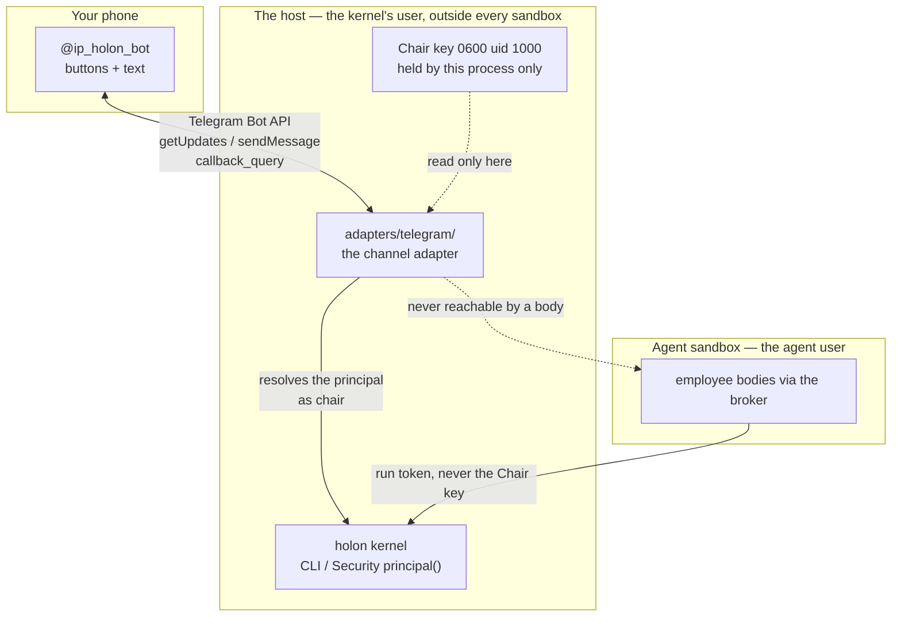

# The Chair channel as a live control surface — architecture, measured

Status: 2026-10-23. Repo `cf26467`. Live instance `/home/ishanp/holon`.

You asked for three things: a new bot token, the old one retired, and an architecture for a
button-driven interaction surface that lets you operate and align the organization from your
phone. This record answers each, and it separates what is **measured and done** from what is
**designed and not built**.

---

## 1. The token: rotated, and blocked on one Telegram rule

**Measured.** The new token is a *different bot* from the old one:

| | id | username | name |
|---|---|---|---|
| old | 8889773233 | `ip_operant_testing_bot` | Operant Testing Bot |
| **new** | 8332461139 | `@ip_holon_bot` | **Holon AgenticOS** |

so the production identity is now `@ip_holon_bot`, which is what you intended.

**Where tokens actually lived** — measured, not assumed. Two independent sources, both of which
your own operator notes said had to be rotated together (`~/.operant/org/employees/dispatcher/
MEMORY.md`: *"If zeroclaw, rotate `.env` + `operant.toml` token and restart gateway"*):

```
/home/ishanp/.operant/operant.toml:109   telegram_token = "8889773233:…"
/home/ishanp/.operant/.env:2             TELEGRAM_BOT_TOKEN=8889773233:…
```

Rotating only one would have left the gateway on the old bot. **Both were replaced**, the gateway
was restarted, and the running process now resolves the new bot. Backups: `/var/tmp/ishanp-agentic/
operant.toml.bak`, `env.bak`, `operant.new.toml`, `env.new`.

### The one thing I cannot do for you

```
curl getChat?chat_id=5297486612   →  {"ok":false,"error_code":400,
                                      "description":"Bad Request: chat not found"}
getUpdates                        →  []
```

**A Telegram bot cannot start a DM.** The new bot has no conversation with you, so the digest
fails with `chat not found`. I proved the wiring is correct rather than guess at it — a control
test with the old token restored delivered cleanly (`chair notify: 1 sent, 0 failed`), which
isolates the cause to the missing conversation and nothing else.

**To close it: send `/start` to `@ip_holon_bot` once.** The moment you do, the digest reaches it
with no further change. Until then the kernel keeps the item owed and records the failure by name
rather than marking it sent — which is exactly the `dropped_marker` behaviour working correctly.

Two messages reached you on the old bot during this work, and one `question` is owed to the new
one (`msg_01M5K5QDAWEE967TFED0M30ACN`) and will be retried by the heartbeat.

---

## 2. The surface area, measured

The registry is the source of truth, so I read it rather than describe it. **124 commands in
four actor classes:**

| Actor | Count | Meaning |
|---|---|---|
| `chair` | **55** | Chair-only: hires, approvals, routines, memory, backups, isolation |
| `any` | **48** | safe for any authenticated principal: reads plus a few safe writes |
| `employee` | **13** | what a body may do: claim, submit, msg, run heartbeat |
| `kernel` | **7** | internal: tick, salvage, post-execute |
| `intake` | 1 | department intake |

**The live organization behind it:** 3 departments, 7 employees — all seven bound to the `operant`
driver, none to `jcode`. Work: 41 cancelled, 10 done, 1 open; 2 `retro` stages ready; 0 awaiting
your approval; 0 needs-input; 0 audit samples.

**What `holon status` already gives you** — and this matters, because it is *already* the shape a
button UI needs:

```
work: cancelled=41, done=10, open=1
ready stages: retro=2
awaiting YOUR approval: 0   awaiting CEO/HOD approval: 0
needs your input: 0   audit samples to judge: 0
organization: 3 departments, 7 employees · auth: configured
```

**And `pending_for_chair()` returns a list of strings** — the digest is prose, not structure:

```
['decision model unavailable (rubric): HTTP 429 …',
 'question from emp:emp_01M4RAJZDXGFHHQSDGJA23ZJBE: Awaiting your /start to @ip_holon_bot …
  (holon msg thread msg_01M5K5QDAWEE967TFED0M30ACN)']
```

That is the single most important structural fact in this audit: **the kernel has never published
machine-readable intent.** Buttons need a stable id and a verb per row. Today a button could only
carry a copy of the prose.

### The gap, stated plainly

```
grep -rn "inline_keyboard|callback_query|editMessageText|answerCallback" holon/ adapters/
  → no matches
```

There is **no bot-UI primitive anywhere in the distribution**. The notify seam is
`[notify] command` with `{message}` substituted — one string out, nothing back in. So a button
surface is genuinely new work, not a configuration change.

---

## 3. Architecture: where buttons belong, and the one law that decides it

The design is forced by two existing laws, so there is very little freedom here.

**Law 2 — no harness named under `holon/`.** Telegram is a harness/platform. So **no button code
lives in the kernel.** Everything below lives in `adapters/`.

**The Chair key is a capability, not a session.** Measured:

```
/home/ishanp/.config/holon/keys/01m4sf0wr27mgs9e1327aqxp1z.chair    0600  uid 1000
```

`security.principal()` resolves a local process holding that key to `Principal("chair")`. And
`holon/execution/isolation.py` deliberately *withholds* that key from every sandboxed body —
`secrets()` lists it first, and `test_the_chair_key_never_reaches_a_harness` pins it.

**So the boundary draws itself:** the adapter process runs **as the kernel's user on the host,
outside every sandbox**, holds the Chair key, and is the only thing that ever speaks for you.
An employee body must never be able to reach that process's seat. This is the same trust
boundary isolation already enforces, applied to a new seat.



Note the dashed lines are the ones the guards test: a body authenticates with a run token and can
never become Chair; the adapter authenticates *as* Chair and is never exposed inside the sandbox.

### The four layers

| Layer | Where | Owns |
|---|---|---|
| **1. Intent** | `holon/execution/` — a kernel-side `chair_actions()` | the *authoritative* list of what a principal may be offered, with a stable `action_id`, a verb, a confirmation policy, and the CLI command it maps to. Derived from `REGISTRY`'s actor classes, never hand-listed — the same lesson as `AGENT_COMMANDS` |
| **2. Render** | `adapters/telegram/render.py` | a `ChairAction` → an inline keyboard. Knows Telegram, knows nothing about Holon's internals |
| **3. Session** | `adapters/telegram/bot.py` | long-poll `getUpdates`, `callback_query` → `answerCallback` → run the verb → `editMessageText` with the result. Renders `pending_for_chair()` as rows with `msg_reply:<id>` buttons |
| **4. Transport** | `adapters/telegram/send.py` | the outbound direction the kernel already shells: `[notify] command` gains `{buttons}` and `{actions_json}` |

**Step 1 is landed** (`dbfb878`), and building the guard first corrected the design. The rule
above said "derived from `REGISTRY`, filtered to `actor="chair"`". That is wrong, and the guard
caught it: `status` is `any` and `msg reply` is `employee`, so a strict chair-only list ships a
channel with **no landing screen and no way to answer an employee** — the two things the channel
exists for. The real rule is:

```python
CHAIR_ACTION_ACTORS = ("chair", "any", "employee")   # never kernel, never intake
```

**116 actions**, with all four designed screens resolving through
`chair_action_meta()`. This is safe because the actor gate is enforced where the command *runs*,
not where the button is drawn — the bot pressing `status` and a body pressing `status` are the
same command under different principals. Mutation-verified: narrowing to chair-only, and dropping
read-only actions, each fail the guard on a real assertion.

Layer 1 is the only part that touches the kernel, and it is deliberately small: it *describes*
actions, it does not execute them. That keeps law 2 intact — "approve this plan" is kernel
vocabulary; "send a message with an inline keyboard" is not.

### Why a kernel-owned intent list, not an adapter list

The registry already carries the truth about who may do what. A second hand-maintained list in
the adapter would drift — which is precisely the defect in the regression ledger:

> *"the MCP fence was a hand-maintained tuple, so a command added to the registry with actor `any`
> was silently unreachable"* — and its guard `test_the_allowlist_is_derived_from_the_actor_class_not_hand_listed`.

So `chair_actions()` derives from `REGISTRY`. I checked the rule it must follow rather than assume
one, and the first check was wrong — I compared `' '.join(path)` against `agent_commands()`'s
**tuples** and got 0 matches, which would have implied the fence is disjoint from the registry.
It is not. The real rule, measured:

```
AGENT_ACTORS  = ('any', 'employee')          # the two actor classes a body may call
AGENT_BLOCKLIST = ('mcp','help','lint','whoami','submit','skill check','contract schemas')

actor='chair'     55 / 55   agent-invisible      ← the whole Chair surface
actor='any'       42 / 48   agent-visible        ← 6 blocklisted: mcp, help, lint, whoami, skill check, contract schemas
actor='employee'  12 / 13   agent-visible        ← submit blocklisted (an agent hands in via its own run token)
actor='kernel'     0 /  7   agent-invisible
actor='intake'     0 /  1   agent-invisible
```

**So `actor='chair'` is exactly the disjoint set, and it is 55 commands.** The derivation is
sound — but it is `actor == 'chair'` *plus* the blocklist discipline, not a fresh hand-list. The
guard I owe in step 1 is therefore: a chair command must never appear in `chair_actions()`'
agent twin, and a command promoted from `any` to `chair` must disappear from the agent fence in
the same commit.

One consequence worth stating: the 42 `any` commands an agent *can* reach are the same commands
the bot would offer you. That is not a conflict — the actor gate is enforced at the CLI seam, so
a body pressing `holon status` and you pressing `holon status` are the same command under
different principals, and only you can reach the 55.

---

## 4. What the buttons should be — from the measured surface

Not 124 buttons. Four screens, each mapped to a real command I verified exists:

**`/start` → Status.** `status` output, then five buttons:
`Approve [n]` · `Needs input [n]` · `Work` · `People` · `Doctor`

**Approvals** (`plan queue` → `plan approve|reject`). This is the highest-value surface: the
organization stalls without you, and it is the one thing a digest cannot do well. Each pending
approval becomes a row with `plan approve <id>` / `plan reject <id>`, and a grade choice.

**Needs input** (`pending_for_chair()`). Renders the strings above as rows, each carrying the
message id, so a button is `msg reply <id>` rather than a retyped sentence. This is what closes
the "which key should I use" gap you hit earlier.

**Org control** — the Chair's 55 commands, grouped by consequence:
*hiring* (`hr hire|pause|fire`) · *work* (`task retry|cancel|replan`) · *routines*
(`routine add|schedule enable|disable`) · *knowledge* (`kb seed|memory promote|retire`) ·
*trust* (`isolation plan|apply`, `keys list`, `backup`, `restore`).

**Trust row uses the gate that already exists.** Measured on the registry, and this corrected my
own first draft: I had proposed a new `confirm` metadata column, but the kernel has none — `risk`
exists only as a `task add`/`routine add` *argument*, not as command metadata. What the registry
*does* already carry is `--force`:

```
restore          path --force --verify-only
keys gc          --keep --apply --force
isolation apply  (no gate at all)
```

So two of the three destructive commands already require an explicit `--force`, and the adapter's
job is simply **never to pass it on the first tap** — the two-step is a rendering rule, not new
kernel machinery. That is a much smaller change than I first proposed.

The exception is real and worth naming: **`isolation apply` had no gate**, and it rewrites the
ACLs of the whole instance.

**Now closed** (`7518afa`): `isolate apply` requires an explicit `--force`, and the real CLI
refuses with *"isolation apply rewrites every ACL on this instance; pass --force (read `holon
isolation plan` first)"*. Mutation-verified — removing the gate fails the test, and the failure
shows the command proceeding to real `setfacl` calls, which is what the gate stops. `isolation
plan` stays ungated on purpose: reading what *would* happen is how you decide whether to spend the
force.

### The free-text path, which matters more than buttons

Buttons are for navigation and clear verdicts. But most of what you ask is a *question*, not a
button press. So the adapter also registers the Chair's free text as a `holon msg reply` to a
session, and offers `holon recall`, `holon ask` and `holon status` as typed commands. The rule
that keeps this honest: **a typed command is parsed by the same actor gate as any other**, so a
typo can never widen your authority — it either matches a verb you already hold or is refused.

---

## 5. What I have not built, and the order I'd build it in

This is a design, not a running bot. Concretely not done: no adapter directory exists, no
`chair_actions()`, and the notify seam still carries one string.

The order that keeps every step verifiable, and the gate each step owes:

| # | Step | Gate before it counts | Status |
|---|---|---|---|
| 1 | `chair_actions()` in the kernel, derived from `REGISTRY` | a guard pinning both halves of the derivation | **landed `dbfb878`** |
| 2 | structured digest rows beside the prose | the digest still renders for a plaintext `[notify] command` (backwards compatible) | **landed `956bef6`** |
| 3 | `adapters/telegram/` render + session, long-poll only | a fake Bot API (`tests/fake_telegram.py`) with the same shape as `tests/fake_notion.py` |
| 4 | wire it as the live `[notify] command` | **one test crosses the seam with the real artifact**: a real prepared digest rendered into a real `sendMessage` call |
| 5 | `--force` gating for destructive buttons | a guard that the adapter never passes `--force` on a first tap, and that `isolation apply` gains its own gate before it is button-reachable |

Step 4 is the one that makes it real, and it is the one most easily skipped — the same lesson the
AGENTS.md records for interface packages: *"an interface package is done only when one test
crosses the seam with the other side's real artifact."*

### Step 2 landed, and the live probe caught a defect the tests would not have

`digest_rows()` (`956bef6`) returns one structured row per prose line, **derived from those lines**
rather than restated, so order, dedupe and count cannot drift from what the Chair reads. The prose
stays — the live `[notify] command` is a plaintext shell and the prose is the contract.

Running it against the live instance found a defect in my own first cut that the test suite had no
shape to catch: the owed question's prose ends `(holon msg thread msg_01M5K…)` and the id contains
an **uppercase** letter. A lowercase-only id class silently dropped the action from every row that
names a message — a button that cannot answer an employee's question is precisely the gap this
surface exists to close, and it would have failed invisibly. The class is now case-sensitive on
purpose, and a guard pins that exact live row shape.

```
kind=question  action=msg thread msg_01M5K5QDAWEE967TFED0M30ACN   ← pressable
kind=notice    action=None                                       ← classifier-down, named as unpressable
```

The row without an id still appears in the button surface, labelled as having no action — an
unpressable row the Chair can see is better than a silently dropped one.

### The honest risk

The largest risk is not Telegram. It is that **step 3 changes where the adapter runs**, and the
adapter must hold the Chair key on the host *outside every sandbox*. That is the one property no
test can prove without the isolation boundary actually being applied — and it is not, so the
`holon-broker` step and the adapter step must land together or not at all.
